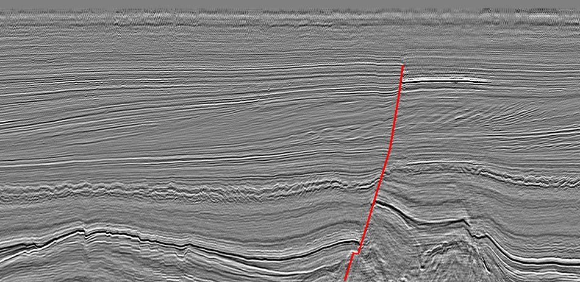

# seismic-fault-labeling

Interpreter-style sparse fault labeling on the Netherlands F3 survey: from fault sticks to training masks.

## What this does

Seismic interpreters label faults as **sticks** (polylines) on every Nth inline. Most of the volume stays unlabeled. This repo turns those sparse sticks into masks that a segmentation model can train on, while keeping track of what was *not* labeled.

```
F3 SEG-Y ──► extract_inlines.py ──► inline PNGs (1 pixel = 1 trace sample)
                                         │
                                    labelme (LineStrip = fault stick)
                                         │
                                         ▼
                 sticks_to_mask.py ──► per-inline masks + QC overlays
                                   └─► labels_sparse.npy (il, xl, t)
                                         1 = fault, 0 = labeled background,
                                         255 = unlabeled (ignored by the loss)
```

## Results on F3 (one fault, `fault_0`)

| Quantity | Value |
|---|---|
| Survey grid | 651 inlines (100–750) × 951 crosslines (300–1250) × 463 samples (0–1848 ms, 4 ms) |
| Traces in SEG-Y | 600,515 of 619,101 grid positions (18,586 empty) |
| Inlines labeled | 41 (every 10th inline, 100–500), 6.3% of the volume |
| Fault pixels | 0.14% of labeled pixels |

## Notes from doing it

- **The SEG-Y isn't a full grid.** The file is missing traces in one corner (inlines ~710–750, ~370 crosslines each), so segyio's regular-grid reader miscounts the inlines. `extract_inlines.py` falls back to rebuilding the geometry from the trace headers and reports duplicate and empty positions.
- **Empty traces should not be labeled as background.** Zero-filled positions belong in the ignore class, not "no fault."
- **The class imbalance is extreme.** At 0.14% fault pixels, plain cross-entropy learns to predict "no fault" everywhere. This calls for Dice or focal loss, or class weighting, and evaluation by precision/recall, not accuracy.
- **Label confidence varies.** Stick length drops from ~1,000 px to under 130 px on some inlines where the fault fades. Those labels are the least reliable.
- **Label QC matters.** One inline had a stray zero-length stick from a double-click. It only showed up in the per-inline stick counts.
- **Tooling.** labelme was used because it supports polylines (`linestrip`). Label Studio has no polyline tool.

## Usage

```bash
pip install segyio numpy matplotlib pillow labelme

python extract_inlines.py --segy F3.sgy --out inlines --step 10
labelme inlines/             # Edit → Create LineStrip, label "fault_<n>"
python sticks_to_mask.py --dir inlines --width 3
```

Any label starting with `fault` counts as a fault. Use one name per fault across inlines (`fault_0`, `fault_1`, ...) so sticks can later be linked into surfaces.

## Data

F3 Demo 2023 from dGB Earth Sciences' Open Seismic Repository (dgbes.com/data). It was exported from OpendTect as post-stack 3D SEG-Y. The data is not included in this repo.


